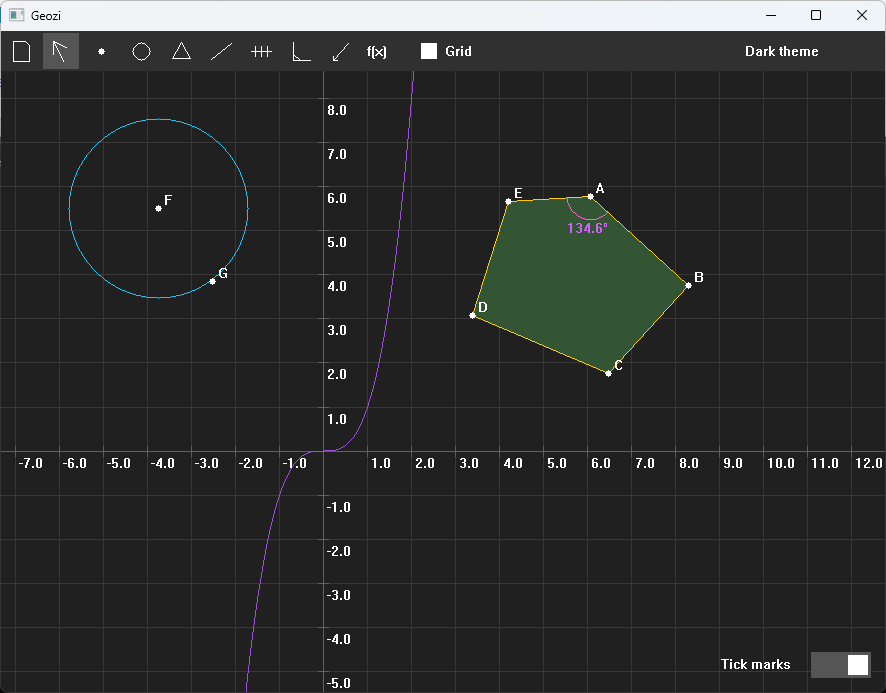

# Geozi

a small GeoGebra-like geometry app written in Rust, using raw Win32 calls and a pixel buffer for rendering. no GUI framework or external crates.




---

## features

- points, segments and lines
- circles defined by two points or by a radius
- parallel and perpendicular lines
- freeform and regular polygons
- angles between 3 points or 2 lines
- distance and area measurements
- a pen tool with an eraser and a few colors
- function plotting with `f(x)`
- undo with `Ctrl+Z`
- select and delete objects
- zoom, pan and an adaptive coordinate grid
- dark and light themes
- save and load scenes using `.gsp` files

## how it works

Geozi is written in Rust, but instead of using something like Qt or egui, I went with the Win32 API directly.

The window, message loop, dialogs and controls are all handled through manually defined Win32 bindings. Rendering is done into a pixel buffer which is then drawn to the window using `StretchDIBits`.

It's mostly a project to learn how this stuff works under the hood, without relying on a GUI library to handle everything for me.

Since it uses Win32 directly, it's Windows-only for now.

## building

you need Rust and the Windows MSVC build tools.

```bash
git clone https://github.com/danterry898/geozi.git
cd geozi
cargo run --release
```


## controls

- **Cursor:** pan around the scene
- **Point:** create, connect and move points
- **Circle:** create a circle using a center and a point, or enter a radius
- **Polygon:** draw a polygon or create a regular one
- **Line:** create parallel or perpendicular lines from an existing line
- **Helpers:** measure distances and areas
- **Angle:** measure an angle using 3 points or 2 lines
- **Pen:** draw freely or erase strokes
- **f(x):** enter a mathematical expression and plot it

`Ctrl+Z` undoes the last action, `Delete` removes the selected object, and `Ctrl+A` selects all points. Use the scroll wheel to zoom.

## function plotting

The function parser is in `expr.rs`. It's a small recursive-descent parser that evaluates expressions without an external library.

Supported operators:

- `+`, `-`, `*`, `/` and `^`
- parentheses and unary signs
- `sqrt`, `exp`, `ln`, `log` (base 10)
- `sin`, `cos`, `tan` and their inverses
- `abs`, `pi`, `e` and `x`

The parser handles operator precedence, and exponentiation is right-associative, so `2^3^2` is evaluated as `2^(3^2)`.

Functions are plotted by sampling the curve across the screen, one column at a time. Large jumps between consecutive points are treated as discontinuities, which avoids drawing a line straight across an asymptote such as the one in `tan(x)`.

One thing to keep in mind: implicit multiplication isn't supported, so write `2*x` instead of `2x`.

## saving scenes

Scenes are saved as plain-text `.gsp` files.

The file is split into sections for each object type: `POINTS`, `CIRCLES`, `SEGMENTS`, `LINES`, `DIRECTED`, `POLYGONS`, `ANGLES`, `STROKES` and `FUNCTIONS`. Each section starts with the number of entries it contains.

Function expressions are stored as text and parsed again when the file is loaded, so the files stay readable and can be edited manually.

## source files

- `main.rs` — creates the window and starts the message loop
- `app.rs` — application state, input handling and drawing
- `geometry.rs` — geometric objects and scene data
- `expr.rs` — function parser and evaluator
- `render.rs` — software rendering
- `ui.rs` — toolbar and submenus
- `theme.rs` — colors and themes
- `dialog.rs` — popup dialogs
- `storage.rs` — saving and loading `.gsp` files
- `control.rs` — undo system
- `win32.rs` — Win32 bindings

## limitations

- Windows only
- no implicit multiplication in function expressions
- no object list to manage or rename plotted curves yet

## maybe later

- export scenes as images
- curve intersections and tangents
- touch and pinch zoom
- a Linux/macOS port (would require replacing the Win32-specific parts)

## license

MIT. See [LICENSE](LICENSE).